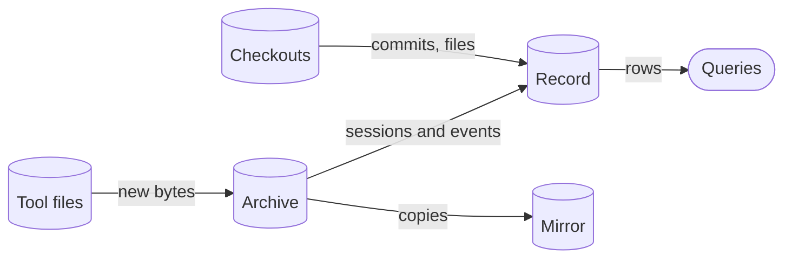

# agent-record

> Session record for coding agents: every past session on this machine, queryable and joined to its commits

[](https://github.com/cniska/agent-record/actions/workflows/check.yml) [](LICENSE)

It keeps each session verbatim in one SQLite database, even after the tool that wrote it deletes its own copy. It is not memory, since it puts nothing into an agent's context, and it gates nothing.

- `agent-record sync` reads the session files of Claude Code, Codex, Grok, pi and omp into that database, with the commits of the repos those sessions worked in and the hook event log any Claude Code plugin writes in the format [`SPEC.md`](SPEC.md) §2.13 defines.
- `agent-record query` and `agent-record sql` read it. Search comes first: `query search` finds where earlier work was said, decided or ran into friction, and `query thread` shows what happened around it.
- It needs no credential, has no per-token cost and never reaches the network.

## Install

agent-record runs on [Bun](https://bun.sh), which [mise](https://mise.jdx.dev) installs for it. With mise installed:

```bash
git clone https://github.com/cniska/agent-record.git
cd agent-record
mise trust && mise install
```

`mise install` installs Bun, actionlint and the dependencies, and in the clone links `agent-record` into `~/.bun/bin`. Add that directory to your `PATH` if it is not there yet. Then build the record and check it:

```bash
agent-record sync
agent-record doctor
```

Then install the Claude Code plugin, the preferred way to keep the record current and point every session at it:

```bash
claude plugin install cniska-record@cniska
```

## Why

Git keeps what landed. Everything else an agent did lives in each tool's own session files, split by tool and by project, and the tools delete them: Claude Code after 30 days by default (`cleanupPeriodDays`). agent-record keeps those files and joins them to the commits they made, so you can ask:

- **Why is this code like this?** Go from a commit to the session that made it and read what you asked for and corrected there.
- **What did we already try?** A dropped approach never reaches git. Read what was tried and dropped, months back and in another repo.
- **What do I keep correcting?** Corrections, failed commands retried unchanged, checks an agent skipped: patterns that show only when counted over hundreds of sessions.
- **Which ways of working hold up?** The record ties a feature's commit and the fixes that followed it to the sessions that made them, in every repo.
- **Where does work stall?** How long a task takes from your prompt to origin, and which commits sat unpushed.

`rg` over the transcripts finds a phrase from last week. It cannot search what the tools have deleted, and it cannot count or join: group corrections, tie a session to its commits, or check whether the files a session touched have changed since.

An agent reading the record finds the friction that repeats; a change to a skill, gate or hook removes it; and the record shows whether that friction dropped after the change.

## Commands

Each command prints one JSON line. The essentials:

| Command | Does |
| --- | --- |
| `agent-record sync` | Read every tool's new session bytes and the commits of the checkouts they name into the record |
| `agent-record doctor` | Judge whether the record is current and readable, naming the fix for each problem |
| `agent-record query search "<words>"` | Find messages by keyword |
| `agent-record query thread <id-prefix> [--at <ts>]` | Read the exchange around a hit |
| `agent-record query list` | Name the queries |
| `agent-record sql "<select>"` | Run one read-only statement |

[Commands](docs/commands.md) lists every command and where the record lives.

Where the data flows, with tool files standing for the session files and the hook event logs:



## Docs

- [Commands](docs/commands.md): every command, and where the record and its archive live.
- [Trace](docs/trace.md): what `query tasks` and `query trace` show, and where the transcripts leave gaps.
- [Mirror](docs/mirror.md): the copy of the archive each `sync` keeps in iCloud Drive, and how to restore the archive from it.
- [Claude Code plugin](docs/plugin.md): what the plugin does at session start.
- [Development](docs/development.md): setup, checks and layout, for working on this repo.
- [Releasing](docs/releasing.md): the release workflow, the owner's one-time setup and each release's steps.
