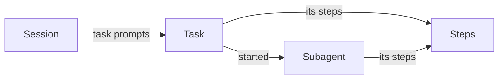

# Trace

`query tasks` and `query trace` read a session's work back as tasks and steps; this page says what they show and where the transcripts they read leave gaps.

## What they show

- **Tasks:** `query tasks <id-prefix>` lists a top-level session's tasks, latest last. A task runs from one task prompt to the next, with the subagents started in it. Its id is the turn id of the message that opens it. `SPEC.md` defines a task prompt (§2.12) and both queries (FR-92).
- **Steps:** `query trace <id-prefix>` prints one task's steps, one JSON line per row in time order: the session and each subagent as `agent` steps with their tokens, each tool call with its target and `git` subcommands, skill loads, compactions, and hook gates and verdicts. Each step prints a `started` line and, once it ends, an `ended` line with its `ms`. A top-level session traces its latest task, or the one `--task <id-prefix>` names.
- **Subagents:** a subagent traces itself and every subagent under it, in the task it started in. Name it by its session id `<id>@<root>`, by `<id>`, by its transcript file's name `agent-<id>`, or as `agent_<id>`.

What one session's work holds:



From a session in the record: its task ids, then four of the task's lines: the start of an `Agent` call, the start of the subagent it started, the end of one of that subagent's tool calls and the subagent's end, each cut to a few fields by `jq`, with lines left out where `…` stands. The task holds the session's own steps and a subagent it started, named `<id>@<root>`:

```text
$ agent-record query tasks 3aeacb3c | jq -r '.result.rows[][0][0:8]'
9368bfa1
628e6df2
8e88bf3b

$ agent-record query trace 3aeacb3c --task 9368bfa1 --rows 200 | jq -c '.result.rows[][0] | fromjson | {session, step, phase, name, ms} | del(.[] | nulls)'
…
{"session":"3aeacb3c-2a9a-497a-afa4-d2c05b805f95","step":"tool","phase":"started","name":"Agent"}
{"session":"a1c0d48dc2343637e@3aeacb3c-2a9a-497a-afa4-d2c05b805f95","step":"agent","phase":"started"}
…
{"session":"a1c0d48dc2343637e@3aeacb3c-2a9a-497a-afa4-d2c05b805f95","step":"tool","phase":"ended","name":"Bash","ms":3186}
…
{"session":"a1c0d48dc2343637e@3aeacb3c-2a9a-497a-afa4-d2c05b805f95","step":"agent","phase":"ended","ms":386032}
```

## What older transcripts lack

Claude Code changes what its transcripts hold from one version to the next. Measured on the versions from 2.1.217 to 2.1.295:

| Field | The trace reads it for | Where it is missing | What the trace shows instead |
| --- | --- | --- | --- |
| A response's final usage line, in a subagent's transcript | Output tokens on a subagent's `agent` step | Up to 2.1.272 nearly every subagent response has one. From 2.1.282 Claude Code writes each content block as it streams, carrying the output count from the stream's start, and often never writes the line with the final count: a background subagent's responses mostly lack it, and from 2.1.286 many of a foreground subagent's do too | Output tokens that are a floor, often far below what the subagent wrote; input and cache tokens are whole. A top-level session's responses carry their final count in every version |
| A subagent's metadata file, naming the call that started it and its agent type | A subagent's `parent`, `agentType`, and whether it failed | A few subagents in every version, with no version boundary | The subagent under its top-level session, with a null agent type, ending ok since no call is known to have failed it; `sync` counts each in its report |
| The turn id on a typed message (Claude Code's `promptId`, Codex's `turn_id`) | A task's id | Present in every Claude Code version measured. Codex writes none on the instructions it injects before its first turn, and Grok, pi and omp write none at all | A task id that is the opening message's own id |
| A preloaded skill's body in a subagent's transcript | `skill` steps with `how: preload` | Seen from 2.1.285, the first version measured whose subagents preload skills | No `preload` step for a subagent that ran earlier |
| A hook event log line | `gate` and `verdict` steps | Every session from before a workflow's hooks started logging, and every session whose workflow logs nothing | No `gate` or `verdict` step |

## Other limits

- **One session and its subagents:** a trace never joins sessions. A `/clear`, a hand-off to a new session, a headless `claude -p` run and a scheduled routine each start a session of their own, so work that spans them is traced one session at a time.
- **Task boundaries are judged from text:** an owner message opens a task only when the agent has said something first, it is not an interrupt, and it was not typed while a turn ran (FR-70, FR-90). A new request typed after the agent ended on a question, or opening with a push-back word, or a short one opening with a go-ahead word (FR-70), reads as an answer, correction or go-ahead, so its work folds into the task before it.
- **Claude Code first:** a Codex session traces with its tool calls, skill reads and tokens, but Codex injects `AGENTS.md` as the first user message, so its first task opens there. Hook events, host refusals and preloaded skills come from Claude Code only.
- **Gates and verdicts need a hook log:** they appear only where a plugin's hooks write them to its event log and `sync` archives it (FR-78).
- **The `git` field is read from the command text:** each `git` invocation the shell command names counts its subcommand, `git grep` included, and a pipe into `grep` does not. A git run inside a script, a function, `bash -c` or a `$(...)` is not seen, and a run listed in the command counts even when an earlier step failed and it never ran.
